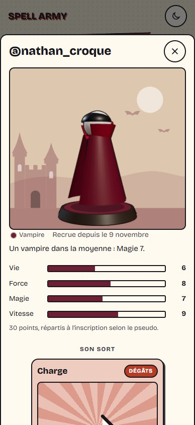
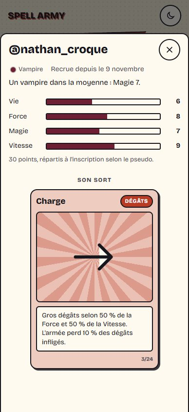
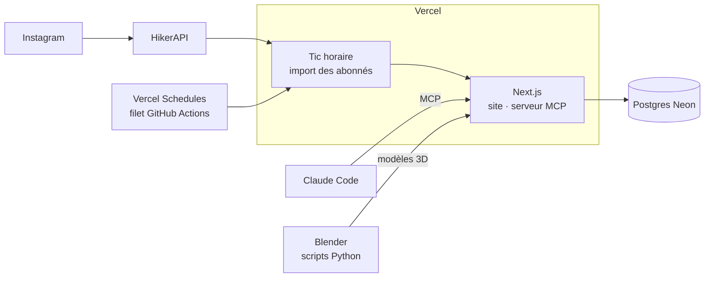

# Wizard Army

Le code source de Wizard Army, un jeu qui se joue en suivant un compte Instagram : chaque abonné
devient un personnage, et tous ensemble forment une armée qui affronte un monstre par jour.

Le jeu est en cours de développement et pas encore en ligne. C'est un projet de loisir, qui me
sert aussi à apprendre deux outils : les serveurs MCP et Vercel.

| La fiche d'un personnage | La carte de son sort |
|---|---|
|  |  |

*Prototypes de l'interface, au format téléphone.*

## Le jeu

- **S'abonner, c'est s'enrôler.** Il n'y a ni inscription ni compte : suivre le compte donne un
  personnage, que chacun retrouve sur le site.
- **Un personnage tiré de son identifiant Instagram.** Une classe parmi huit (magicien, golem,
  guerrier, nain, vampire, druide, paysan, fée), quatre statistiques (Vie, Force, Magie, Vitesse)
  qui se partagent 30 points, et un verdict, de « mal né » à « excellent ». Un magicien peut être
  excellent ou mal né : on va voir sur le site si le sien est bon.
- **Un sort par personnage**, tiré à l'inscription dans une réserve de sorts, indépendamment de la
  classe.
- **Un combat par jour, en tour par tour.** À chaque action, un personnage tiré au sort lance son
  sort avec la puissance de toute l'armée : l'armée donne la force, le lanceur son efficacité. Le
  monstre est dimensionné sur l'armée, et elle peut perdre ; une défaite pousse à faire venir du
  monde.
- **Un combat calculé une seule fois**, déterministe, jamais relancé parce que l'issue déplaît. Il
  produit le script d'une vidéo qui le raconte et met en avant de vrais abonnés.

Les règles complètes sont dans le [game design](docs/game-design.md), l'apparence dans la
[direction artistique](docs/direction-artistique.md).

## Où en est le projet

- **Fait** : le socle du monorepo et sa CI, les personnages calculés, la réserve de 24 sorts,
  l'import des abonnés, le serveur MCP de pilotage, les brouillons 3D des huit classes, le moteur
  de combat, l'annuaire des recrues et la page « Informations ».
- **En cours** : la fiche du personnage, le bestiaire, la saison, puis
  la mise en ligne d'une bêta.
- **Plus tard** : la vidéo de chaque combat.

Le découpage vit dans les [issues](https://github.com/plecart/wizard-army-v2/issues) et les
[milestones](https://github.com/plecart/wizard-army-v2/milestones).

## Architecture

- **Un paquet par domaine** : `combat` et `personnages` sont purs, sans base ni réseau ;
  `donnees` porte le schéma et les migrations ; `joueurs`, l'import ; `apps/web`, le site, le
  serveur MCP et la route du tic.
- **L'import se répare seul** : une passe rapide chaque heure, une complète chaque semaine,
  rejouables sans risque de doublon, sous un verrou. Un filet GitHub Actions prend le relais si le
  planificateur de Vercel tombe.
- **Le pilotage passe par MCP** : calibrage, réserve de sorts, joueurs et modèle de chaque classe
  se gèrent depuis Claude Code, derrière un jeton, et chaque outil destructeur se confirme en deux
  appels.
- **Les modèles 3D sont du code** : chaque classe est un script Python que Blender exécute sans
  fenêtre, et chaque fichier produit est vérifié contre un contrat avant d'être déposé sur le
  serveur, par une commande qui ne passe pas par Claude.

## Stack

| Couche | Technologies |
|---|---|
| Site et API | Next.js (App Router), React, TypeScript |
| Pilotage | Serveur MCP (SDK TypeScript), Zod |
| Données | PostgreSQL sur Neon, Drizzle ORM |
| Modèles 3D | Blender, scripts Python, glTF |
| Infra | Vercel, Vercel Schedules |
| Outillage | pnpm workspaces, Biome, Vitest, GitHub Actions, Dependabot |

## Qualité

- **Tests** : Vitest, avec un Postgres jetable démarré par Testcontainers pour les paquets qui
  touchent la base.
- **CI à chaque PR** : audit des dépendances, lint, format, typecheck, dérive du schéma par rapport
  aux migrations, build et tests.
- **Des paquets purs** : personnages et combat se testent sans base ni réseau, et le hasard dérive
  d'un hachage de l'identifiant ou de la graine du combat, jamais du générateur du langage : à
  graine égale, même combat.

## Les décisions

Le [cadrage](docs/etudes/00-cadrage.md) rassemble les décisions d'ensemble. Chaque choix technique
a son ADR dans [`docs/adr/`](docs/adr/), et les études préparatoires, options écartées comprises,
sont dans [`docs/etudes/`](docs/etudes/).

## Une pipeline de développement par agents IA

Ce projet est développé avec une pipeline pilotée par des agents
([Claude Code](https://claude.com/claude-code)) : des issues triées par une machine à états, un
cycle de PR en TDD, des relectures à contexte vierge, des rôles d'agents choisis selon ce qu'ils
ont le droit de décider, et un humain qui garde les décisions de produit et le merge.

- [`CLAUDE.md`](CLAUDE.md) et [`CONTRIBUTING.md`](CONTRIBUTING.md) décrivent le fonctionnement ;
- [`.claude/skills/`](.claude/skills/) contient les skills de la pipeline ;
- [`.claude/agents/`](.claude/agents/) définit les rôles ;
- [`.claude/rules/`](.claude/rules/) porte les règles toujours actives.

L'historique des issues et des PR montre la pipeline au travail. Faire tourner le projet en
local : [`docs/exploitation.md`](docs/exploitation.md).

## Licence

Code, contenu et visuels : tous droits réservés. Le dépôt est public pour être lu, pas pour être
réutilisé.

Les skills et icônes de tiers copiés dans `.claude/` restent sous leur propre licence :
[`THIRD_PARTY_NOTICES.md`](THIRD_PARTY_NOTICES.md).
