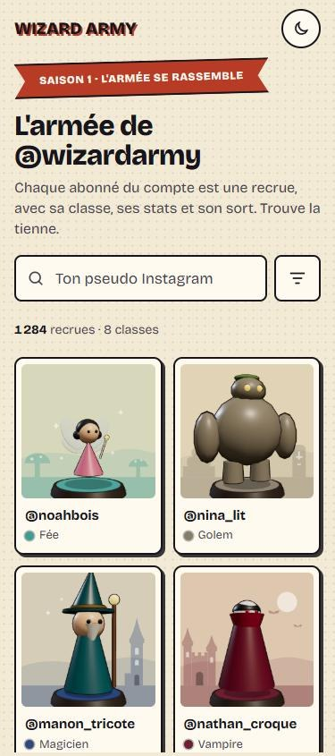
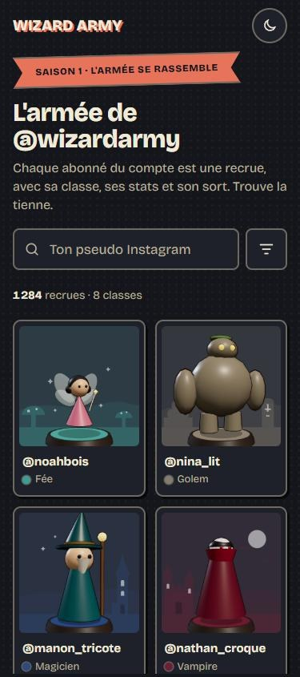
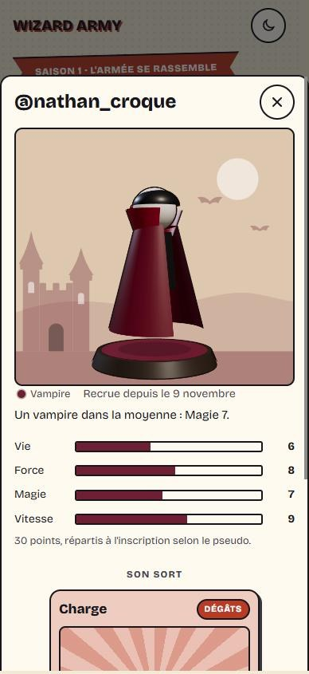
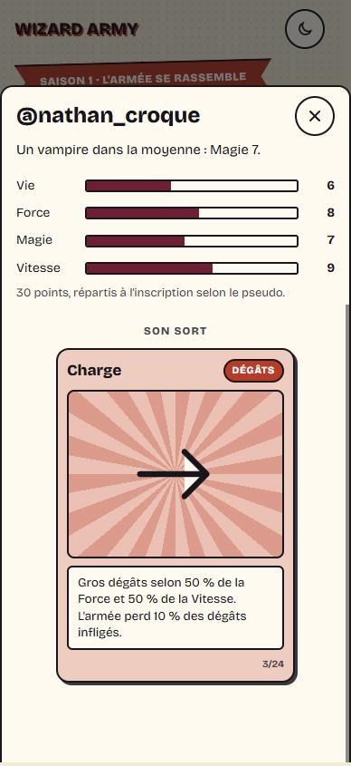
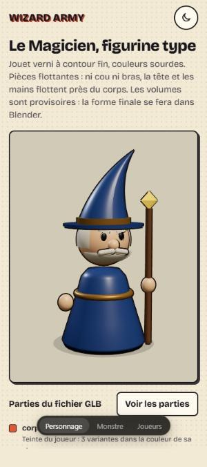
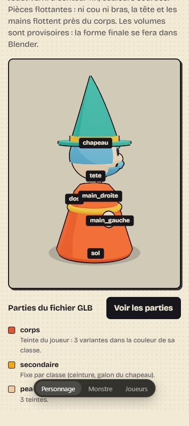

# Wizard Army — Direction artistique

État au 2026-11-16. Ce document détaille la section « Modèles 3D » du [cadrage](etudes/00-cadrage.md)
et l'organisation du site. Le cadrage fait foi en cas de désaccord (rang 1 des sources de vérité).
Il a été arrêté avec le mainteneur sur des prototypes jetables, hors dépôt ; les captures du § 10 en
gardent la trace.

Statuts, comme au cadrage :

- **Décidé** : tranché par le mainteneur.
- **Proposé** : choix de Claude, pas encore validé explicitement.
- **Ouvert** : à trancher plus tard.

## 1. Le style

| Sujet | Règle | Statut |
|---|---|---|
| Ton | **Épique bon enfant.** Les personnages et le visuel sont sérieux ; la narration est légère, parfois comique. Exemple comique : « un magicien qui a à peine la force de porter une épée ne sert que de cure-dent au monstre ». Exemple épique : « il s'élance de toute sa force, motivé par les cris de ses compagnons, et lance un éclair qui achève Globo le Morveux ! » | Décidé |
| Site | **Style BD** : fond crème à trame de points, bordures d'encre de 2 px, ombres décalées de 3 px, titres gras. | Décidé |
| Personnages | **Jouet verni à contour fin** : volumes simples et lisses, vernis brillant, fin contour d'encre. **Couleurs sourdes**, jamais flashy. | Décidé |
| Écran de référence | **Le téléphone d'abord.** Le site est surtout vu sur mobile ; le bureau suit. | Décidé |
| Thèmes | Clair et sombre, choisis par le système, avec un bouton pour basculer. | Proposé |

## 2. Couleurs et typographie

**Couleurs de classe** (Décidé), sourdes, une par classe :

| Classe | Couleur |
|---|---|
| Magicien | `#2e4a7d` |
| Golem | `#857c6c` |
| Guerrier | `#a33b2f` |
| Nain | `#b06a2c` |
| Vampire | `#6e1f33` |
| Druide | `#4f7a3a` |
| Paysan | `#c4a052` |
| Fée | `#3f9c95` |

**Couleurs d'interface** (Proposé), celles des prototypes :

| Jeton | Clair | Sombre |
|---|---|---|
| fond | `#f3ead5` | `#14161c` |
| surface | `#fffaf0` | `#1e2129` |
| encre | `#17161c` | `#f1ead8` |
| texte secondaire | `#47444d` | `#b9b09d` |
| trait | `#17161c` | `#6e6a62` |
| accent | `#b83b26` | `#e8735b` |
| ombre décalée | encre à 85 % | noir à 60 % |

En sombre, l'ombre décalée reste noire : une ombre claire est refusée, trop marquée (Décidé).

**Couleurs d'effet des sorts** (Proposé) : dégâts `#b83b26`, soin `#4f7a3a`, vol de vie `#6e1f33`.

**Typographie** (Proposé) : Bricolage Grotesque (Google Fonts), graisses 400 à 800, une seule famille.

## 3. Le site au MVP

| Sujet | Règle | Statut |
|---|---|---|
| Périmètre | **L'annuaire seul**, sur une page. Ni monstre, ni prochain monstre, ni compteur, ni prédiction : ils viennent après le MVP (cadrage, « Combat et calibrage », ligne « Site »). | Décidé |
| Page | Une petite banderole, le titre, la recherche « Ton pseudo Instagram », puis la liste des recrues en cartes. Un clic sur une carte ouvre la fiche. | Décidé |
| Filtre par classe | Un bouton à côté de la recherche ouvre une **feuille** depuis le bas de l'écran : « Toutes les classes » et les huit classes sur deux colonnes, chacune avec son nombre de recrues. Le filtre actif s'affiche en étiquette qu'on peut retirer. Les rangées de pastilles, qui débordent de l'écran, sont refusées. | Décidé |
| Pagination | 24 cartes par page ; « Précédente », « Page N sur M », « Suivante ». | Décidé |
| Carte | Vignette du personnage sur son décor, pseudo, pastille et nom de la classe. | Décidé |
| Vignettes | Des images rendues par un seul moteur 3D, jamais 24 scènes 3D vivantes : les navigateurs limitent le nombre de contextes WebGL. | Proposé |
| Fiche | En haut, le **pseudo** et le bouton de fermeture ; puis la scène 3D, la classe et la date d'arrivée, une phrase de verdict, les quatre statistiques en barres, « 30 points, répartis à l'inscription selon le pseudo », et la carte du sort. | Décidé |
| Scène de la fiche | Le **socle reste immobile** au sol ; le personnage tourne lentement sur lui-même et **flotte** au-dessus, en montant et descendant. Son ombre sur le socle suit sa hauteur. On peut le faire tourner du doigt. | Décidé |

Au MVP, l'affichage 3D vit dans le site. Il ne devient le paquet commun au site et à la vidéo qu'en
phase 2 ([ADR 0001](adr/0001-architecture-applicative.md), « Paquets »).

## 4. La carte de sort

Chaque sort est une **carte à jouer**, au format 63 × 88.

| Sujet | Règle | Statut |
|---|---|---|
| En-tête | Le **nom** du sort en haut à gauche ; à droite, une **pastille d'effet** : Dégâts, Soin ou Vol de vie. La carte prend la couleur de l'effet. | Décidé |
| Visuel | Une image au milieu de la carte. Le sort la porte en base ([game design](game-design.md) § 2, « Stockage »). Les pictogrammes des prototypes sont refusés. | Ouvert |
| Description | Sous le visuel. **Les variables s'écrivent dans la phrase** : « Gros dégâts selon 50 % de la Force et 50 % de la Vitesse. L'armée perd 10 % des dégâts infligés. » Pas d'étiquettes séparées pour la recette ni pour la forme. | Décidé |
| Pied | Le numéro du sort dans la réserve : « 3/24 ». | Décidé |

## 5. Mise en scène : décor et socle

| Sujet | Règle | Statut |
|---|---|---|
| Fond | Un **décor par classe**, derrière le personnage, dans la vignette comme dans la fiche. Les fonds « halo » et « rayons » sont écartés. | Décidé |
| Sol | Un **socle rond** de figurine : base sombre, dessus à la couleur de la classe. La tuile hexagonale et la simple ombre sont écartées. | Décidé |
| Valeurs par défaut | Chaque classe a, à un seul endroit, son **modèle 3D**, son **décor** et son **socle** par défaut. Un personnage qui rejoint l'armée reçoit ces trois valeurs. | Décidé |
| Changement individuel | Plus tard, chacune des trois valeurs pourra être changée personnage par personnage, par le MCP. Aucun choix n'est fait par le joueur. | Décidé |
| Changement d'un défaut | Quand le défaut d'une classe change, les personnages dont la valeur **était égale à l'ancien défaut** reçoivent le nouveau ; les autres ne bougent pas. Conséquence : un personnage à qui l'on aurait donné à la main exactement le défaut suit lui aussi. | Décidé |
| Réglage | Décor et socle se règlent par le MCP, comme le modèle. | Décidé |

**Règles de dessin du décor** (Décidé) :

- **Trois plans**, tous de la couleur de la classe : un lointain pâle (collines, ou montagnes chez le
  nain) ; l'élément de la classe, plus marqué, sur **un côté** ; un sol plat. Le centre reste libre
  pour le personnage.
- **Rien ne se chevauche.** Les formes d'un même plan se fondent en une silhouette. Rien ne
  s'enfonce dans le sol : tout ce qui le touche s'arrête sur sa ligne.
- **Rien à main levée.** Les bâtiments sont construits et symétriques : une tour est un corps droit,
  un bandeau et un toit en flèche centré sur le corps. Les créneaux sont réguliers ; pierres et arbres
  ont des formes arrondies. Une forme géométrique n'est gardée que si elle représente quelque chose.
- **Les mêmes détails partout** : fenêtres et lueurs claires, portes et ouvertures sombres.

Élément de chaque classe : tour à deux fenêtres éclairées (magicien) ; cairn et pierre levée gravée
(golem) ; rempart crénelé, tour, porte et drapeau (guerrier) ; montagne enneigée et entrée de mine
étayée (nain) ; château à deux tours, lune et chauves-souris (vampire) ; arbres ronds (druide) ;
grange et clôture (paysan) ; champignons et étincelles (fée).

## 6. Les personnages

| Sujet | Règle | Statut |
|---|---|---|
| Construction | **Pièces rigides flottantes.** Ni cou ni bras : la tête flotte juste au-dessus du corps, les mains flottent à côté. Aucune jonction à déformer. | Décidé |
| Animation | Chaque pièce pivote ou se déplace sur son ancre (§ 7) : tête qui tourne, main qui se lève avec son objet, chapeau qui bascule. Ni fusion des volumes, ni poids d'os. | Décidé |
| Variation par joueur | **Aucune au MVP** : un seul modèle par classe. | Décidé |
| Peaux | Teintes claires à moyennes, pas de teintes foncées. | Décidé |
| Monstres | Même matière et même contour que l'armée, environ **2,5 fois** plus grands ; certains plus gros encore. | Décidé |
| Design final | Les modèles des prototypes sont des brouillons. Le design des huit classes et des monstres se fera plus tard, à partir de références du mainteneur. La barbe du magicien ne convient pas ; les yeux de Globo non plus. | Ouvert |

**Pourquoi des pièces flottantes.** Un essai dans Blender, le 2026-11-16, a fait passer le magicien
du prototype jusqu'à un GLB animé :

- la fusion des volumes en une masse lisse apporte peu une fois le contour posé ; elle crénelle les
  frontières de couleur et fait fondre les petits détails ;
- les poids d'os calculés automatiquement déchirent la robe dès que les bras, collés au corps, se
  lèvent ;
- les pièces rigides accrochées à un os, comme le bâton, ne posent aucun problème.

Rapport complet hors dépôt, chiffres mesurés : 13 392 triangles en 20 pièces à l'export ; une
vingtaine de secondes de calcul Blender pour toute la chaîne ; ancres retrouvées exactement à leurs
coordonnées après rechargement dans three.js.

## 7. Le fichier 3D de référence

Le fichier est la référence ; l'outil qui le fabrique est libre. Un designer doit pouvoir déposer un
nouveau fichier qui respecte ce contrat, et tout fonctionne sans toucher au code. Le même fichier sert
au site et à la vidéo.

| Sujet | Règle | Statut |
|---|---|---|
| Format | **Un fichier GLB par classe et par monstre**, stocké en base et géré par le MCP. | Décidé |
| Ancres | Des nœuds nommés : `tete` (pivot de la tête) ; `chapeau`, enfant de `tete` (sommet du crâne) ; `main_gauche` et `main_droite` (objets tenus) ; `sol` (pivot, posé à zéro). | Décidé |
| Ancre `dos` | Pour une cape ou des ailes. | Proposé |
| Pièces | Chaque pièce est un maillage rigide, enfant de son ancre. Pas de squelette exigé. | Décidé |
| Repère | Axe Y vers le haut, personnage tourné vers +Z (convention glTF) ; origine au centre du sol, sous les pieds ; un personnage mesure environ 2 unités de haut. | Proposé |
| Matériaux | Un matériau par partie, nommé : `corps`, `secondaire`, `peau`, `poils`, `coiffe`, `accessoire`, `fixe`. Couleurs unies, sans texture peinte ; le vernis passe par la rugosité et le vernis glTF (`KHR_materials_clearcoat`). Les noms permettront de recolorer une partie lors d'un changement individuel. | Proposé |
| Contour | Ajouté à l'affichage, pas dans le fichier. | Proposé |
| Budget | 30 000 triangles au plus par personnage. | Proposé |
| Fabrication | **Blender**, installé sur le poste le 2026-11-16 (version 5.3). | Décidé |
| Pilotage de Blender | Le serveur MCP officiel de Blender reste candidat. L'essai s'en est passé : Blender piloté par un script Python, sans fenêtre. | Ouvert |

**Ce que ce contrat impose à la fabrication :**

- un fichier par classe, dont chaque pièce porte le nom de son ancre et chaque matériau celui de sa
  partie ;
- des pièces séparées et flottantes, jamais soudées : pas de cou, pas de bras ;
- pas de squelette, pas de poids d'os, pas de texture peinte au MVP ;
- l'origine au sol et l'échelle commune, pour que socle et décor se posent sans réglage.

## 8. Ce qui n'est pas retenu

- **Ambiances écartées** : facettes, voxel, conte sombre, papier découpé, pâte à modeler, feutrine,
  bois peint. Le toon a été gardé un temps puis remplacé par le style BD pour le site.
- **Barbe de sorcier** (longue, en pointe, en mèches, fourchue) : trop particulière.
- **Fusion des volumes et squelette à poids automatiques** : voir § 6.
- **Code seul, sans fichier** (proposition de l'[étude 03](etudes/03-video-et-3d.md)) : le mainteneur
  veut un fichier de référence remplaçable par un designer.

## 9. Points ouverts

| # | Sujet | Ce qu'il faut |
|---|---|---|
| 1 | Design final des huit classes, dont la barbe du magicien. | Références du mainteneur, avant la fabrication des modèles. |
| 2 | Design des monstres, dont les yeux de Globo. | Références du mainteneur, avant le premier monstre. |
| 3 | Visuels des 24 sorts. | À dessiner ; les pictogrammes du prototype sont refusés. |
| 4 | Pilotage de Blender : serveur MCP ou script Python. | À trancher à la fabrication du premier modèle. |
| 5 | Ancre `dos`. | À confirmer avec la première cape ou les premières ailes. |
| 6 | Couleurs d'interface et typographie (§ 2). | À confirmer à la première PR du site. |

## 10. Captures des prototypes

Captures du 2026-11-16, au format téléphone. Le magicien des vignettes est un ancien brouillon ; le
dernier est celui de la page des modèles.

| Annuaire, clair | Annuaire, sombre |
|---|---|
|  |  |

| Fiche | Carte de sort |
|---|---|
|  |  |

| Magicien | Parties et ancres |
|---|---|
|  |  |
